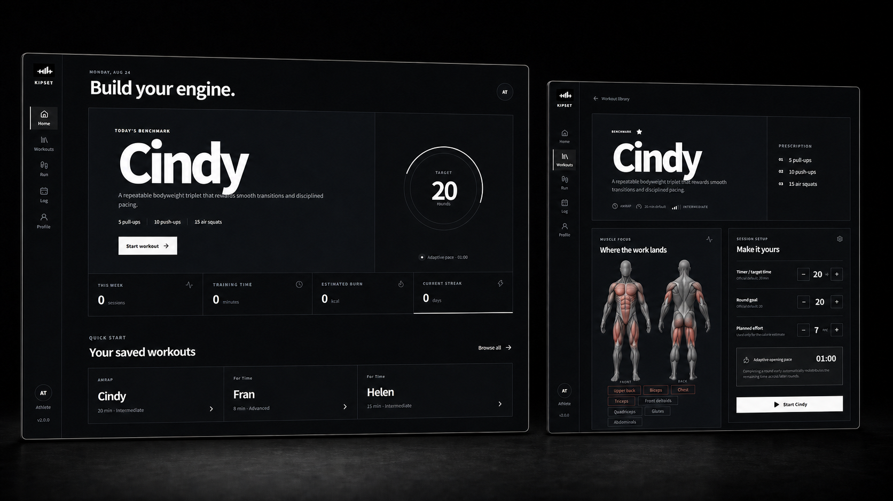

<div align="center">


# KIPSET

**Offline-first functional fitness training for Windows, macOS, and Android.**

[](https://github.com/Kkubuck/kipset/actions/workflows/release.yml)
[](LICENSE)
[](#languages)
[](PRIVACY.md)

[Releases](https://github.com/Kkubuck/kipset/releases) · [Features](#features) · [Build](#build-from-source) · [Privacy](PRIVACY.md) · [Security](SECURITY.md)

</div>



KIPSET combines a curated WOD library, adaptive round pacing, anatomy-based muscle focus, a manual running log, estimated calories, a training calendar, and Instagram Story results in one focused app. No account is required and training data stays on the device.

## Downloads

Builds produced by GitHub Actions are grouped by platform:

| Platform | Artifact | Use |
| --- | --- | --- |
| Windows x64 | `KIPSET-Setup-<version>-x64.exe` | One-click per-user installer |
| Windows x64 | `KIPSET-Portable-<version>-x64.exe` | Runs without installation |
| macOS Apple Silicon | `KIPSET-<version>-macOS-arm64.dmg` or `.zip` | Native M-series build |
| macOS Intel | `KIPSET-<version>-macOS-x64.dmg` or `.zip` | Intel Mac build |
| Android | `KIPSET-Android-<version>-debug.apk` | Installable QA/preview APK |
| Android | `KIPSET-Android-<version>-release-unsigned.apk` | Release input that must be signed before distribution |

Every platform artifact includes a SHA-256 checksum file. Community desktop builds are not yet code-signed or notarized, and the Android release APK is intentionally unsigned. Add protected signing credentials before store or commercial distribution.

## Features

### Curated workout library

- 43 benchmark, Hero, foundation, and running workouts with searchable movements and equipment.
- Category, five-level difficulty, and favorite filters.
- Editable timer and round goals while the official/default prescription remains visible.
- Source links for referenced prescriptions; difficulty and muscle emphasis are explicitly KIPSET editorial classifications.

### Adaptive timer

- AMRAP, for-time, EMOM, intervals, max-rep, and max-load formats.
- Large countdown or elapsed clock, live round split, previous split, pause, undo, and manual finish.
- Completing a round early or late recalculates the next target from the remaining time and remaining goal rounds.
- Keyboard controls on desktop and haptic round/finish feedback on Android.
- Display sleep prevention during desktop sessions.

### Anatomy and scaling

- Original semi-realistic front/back anatomy artwork with separate primary and secondary red heat-map overlays.
- Human-readable muscle names, intended stimulus, equipment, and scaling guidance.
- Black-and-white interface, high-contrast mode, reduced motion, and optional timer sounds.

### History, running, and local data

- Calendar for completed WODs and manually entered runs.
- Monthly sessions, training time, running distance, and estimated calories.
- Distance/time/RPE running entry with pace and speed calculations; no GPS or background location permission.
- Favorites, recent-session repeat, JSON backup/restore, and complete local-data erase.

### Story-ready results

- Total time, rounds, average split, calories, and movement totals.
- 30 locally bundled 9:16 training backgrounds.
- 1080 × 1920 PNG output for Instagram Stories.
- Native save dialog on desktop and Android share sheet on mobile.

### Languages

The interface, workout summaries, prescriptions, equipment, difficulty labels, and muscle names support:

- English
- 한국어
- 日本語
- 简体中文

KIPSET follows the device language on first launch and stores later changes locally.

## Accuracy and safety

Official CrossFit references are used where available and linked from the relevant workout. KIPSET is independent software; its difficulty, muscle emphasis, scaling, and calorie classifications are not official CrossFit guidance.

Calories are estimates rather than measurements. They use activity MET, body weight, duration, and selected RPE. Running bands reference the [2024 Adult Compendium of Physical Activities](https://pacompendium.com/running/); GPS, heart rate, body composition, temperature, and individual efficiency are not included.

Choose loads and movement versions that preserve technique. New or returning athletes should consider the official [PAR-Q+ readiness process](https://eparmedx.com/) and qualified coaching before high-intensity training.

## Controls

| Input | Action |
| --- | --- |
| `Space` | Start or complete a round |
| `P` | Pause or resume |
| `F11` | Fullscreen on Windows |
| `Control` + `Command` + `F` | Fullscreen on macOS |
| Android Back | Close the current overlay or return one app level |

## Privacy and security

KIPSET includes no login, analytics, ads, telemetry, or remote workout API. Electron uses renderer sandboxing, context isolation, disabled Node.js integration, a narrow preload bridge, and an HTTPS host allowlist. Android disables cleartext traffic and application backup. See [PRIVACY.md](PRIVACY.md) and [SECURITY.md](SECURITY.md).

## Build from source

Common requirements are Node.js 22.13 or newer and npm.

```bash
npm ci
npm audit
npm run lint
npm run check:release
```

### Windows

Run on Windows x64:

```powershell
npm run desktop:dev
npm run desktop:windows
```

Outputs are written to `release/portable` and `release/installer`.

### macOS

Run the matching command on macOS:

```bash
npm run desktop:mac:x64
npm run desktop:mac:arm64
```

macOS packages must be built and signed on macOS. CI runs Intel and Apple Silicon targets separately.

### Android

Requires JDK 21 plus Android SDK Platform 36 and Build Tools 35:

```bash
npm run android:debug
npm run android:release
```

The debug APK is installable for QA. The release APK must be signed with a private upload key that is never committed to the repository.

### Browser preview

```bash
npm run dev -- --port 8771
```

## Release pipeline

Every pull request and push runs a full dependency audit, lint, web tests, desktop/mobile bundle tests, Android synchronization, and platform builds. Windows runs on a Windows worker, macOS x64 and arm64 run on macOS workers, and Android runs with JDK 21 and the Android SDK. A `v*` tag publishes all generated files and checksums as a GitHub Release.

```bash
git tag v2.0.0
git push origin v2.0.0
```

Before a public store launch, configure Authenticode, Apple Developer ID/notarization, and Android signing through encrypted repository secrets. Never commit certificates, passwords, API keys, `.env` files, keystores, or provisioning profiles.

## Project structure

- `src/wod-data.js` — WOD database, muscle classifications, and 30 Story backgrounds.
- `src/i18n.js` — complete four-language interface and workout localization.
- `src/fitness-metrics.js` — adaptive pace, movement totals, and calorie estimates.
- `desktop/` — hardened Electron shell for Windows and macOS.
- `mobile/` and `android/` — Capacitor bridge and native Android project.
- `docs/DESIGN.md` — product design principles and reference standards.
- `THIRD_PARTY_NOTICES.md` — dependency and reference credits.

## Trademark disclaimer

KIPSET is independent functional-fitness software and is not affiliated with or endorsed by CrossFit, LLC. “CrossFit” and workout names may be trademarks of their respective owners. KIPSET is a provisional product name; professional trademark clearance should precede commercial release.

## License

Source code is available under the [MIT License](LICENSE). Brand and generated media assets are included in this repository; confirm final brand, trademark, and media rights as part of launch due diligence.
